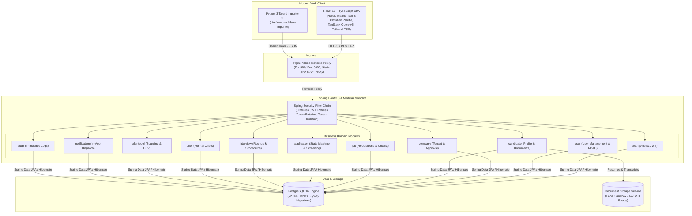

# HireFlow
### Production-Grade Enterprise Recruitment & Applicant Tracking Platform (ATS)

[](.github/workflows/ci.yml)
[](https://openjdk.org/projects/jdk/21/)
[](https://spring.io/projects/spring-boot)
[](https://react.dev/)
[](https://www.typescriptlang.org/)
[](https://tailwindcss.com/)
[](https://www.postgresql.org/)
[](backend/src/main/resources/db/migration/)
[](docker-compose.yml)
[](LICENSE)

---

## 1. Executive Overview

**HireFlow** is an enterprise-grade applicant tracking system (ATS) and recruitment operations platform engineered to manage the end-to-end talent acquisition lifecycle for modern organizations. Built to professional engineering standards, HireFlow pairs deep operational workflow automation with institutional data integrity, multi-tenant company isolation, automated candidate eligibility evaluation, multi-round technical interview scheduling, formal offer management, and passive talent sourcing.

The application is architected as a **Modular Monolith** using **Java 21** and **Spring Boot 3.3.4** on the backend, **React 18** with **TypeScript** and **Tailwind CSS** on the frontend, and **PostgreSQL 16** with **Flyway** for database persistence.

```
Company Registration ➔ Admin Verification ➔ Job Requisition ➔ Candidate Application
       ➔ Automated Eligibility Evaluation ➔ Kanban Pipeline Review ➔ Multi-Round Interviews
       ➔ Scorecard Evaluation ➔ Formal Offer Issuance ➔ Candidate Decision ➔ Official Hire
```

---

## 2. Core Capabilities & Architectural Invariants

### 🏢 Recruiter Operations & ATS Pipeline
- **Dual-Mode Candidate Pipeline:** Switch dynamically between an information-dense **List Table** and an interactive 6-column **Kanban Pipeline Board** (`Submitted`, `Under Review`, `Shortlisted`, `Interview`, `Offered`, `Hired`).
- **Real-Time Search & Eligibility Filtering:** Filter candidates instantly by name or email, and slice the pipeline by automated eligibility status (`Eligible`, `Review Required`, `Ineligible`).
- **Requisition Duplication / Cloning:** One-click cloning of existing job requisitions with academic eligibility criteria pre-populated into a new draft.
- **Pipeline CSV Export:** One-click spreadsheet export generating comprehensive candidate reports.
- **Interview Coordination & 5-Point Scorecards:** Multi-round scheduling (`TECHNICAL`, `BEHAVIORAL`, `MANAGERIAL`, `HR`), room links, and evaluation scorecards with hiring recommendations (`STRONG_HIRE`, `HIRE`, `LEANING_HIRE`, `LEANING_REJECT`, `REJECT`).
- **Formal Offer Management:** Extended compensation terms, base salary, start dates, and expiration dates.
- **Passive Talent Pool & Bulk CSV Importer:** Sourced lead management, candidate tagging, and bulk CSV ingestion.

### 🎓 Candidate Portal & Application Stepper
- **6-Step Visual Application Stepper:** Interactive visual timeline tracking candidacy across all hiring milestones.
- **Profile Completion Meter:** Real-time completion progress tracking education, work histories, and skills.
- **Secure Document Upload:** Resume storage with **Apache Tika MIME-type verification** and SHA-256 integrity checksums.
- **Offer Review & Decision:** Candidates inspect formal offer terms and accept or decline directly in-app.

### 🛡️ Platform Administration & Multi-Tenant Governance
- **Company Verification Gate:** Unverified companies cannot publish job requisitions until approved by a platform administrator.
- **Strict Multi-Tenant Isolation:** Enforced defensively in backend service contracts; recruiters can only access data belonging to their affiliated organization.
- **Immutable Security Audit Log:** Immutable audit logging capturing security actions, company approvals, and status transitions.
- **Defense-in-Depth Authentication:** 15-minute signed JWT access tokens and database-backed SHA-256 hashed refresh token rotation.

---

## 3. System Architecture



---

## 4. Technology Stack Specification

| Component | Technology | Version | Purpose / Architectural Standard |
|---|---|---|---|
| **Backend Language** | Java (LTS) | 21 | Modern type-safe language runtime |
| **Backend Framework** | Spring Boot | 3.3.4 | Modular monolith, dependency injection, REST controllers |
| **Security & Auth** | Spring Security / JJWT | 0.12.6 | RFC 7519 JWT access tokens, SHA-256 refresh rotation |
| **ORM & Persistence** | Spring Data JPA / Hibernate | 6.5.3 | Object-relational mapping, transactional boundaries |
| **Database Engine** | PostgreSQL | 16 | Relational data integrity, 22 normalized 3NF tables |
| **Database Migrations**| Flyway | 10.x | Version-controlled, deterministic database migrations |
| **Document Validation**| Apache Tika | 2.9.2 | Content-based MIME-type detection & SHA-256 hashing |
| **API Documentation** | Springdoc OpenAPI | 2.6.0 | Swagger UI interactive explorer at `/swagger-ui/index.html`|
| **Frontend Framework** | React / TypeScript | 18.3 / 5.6 | Strongly typed component architecture |
| **Build & Dev Tool** | Vite | 5.4.21 | Hot Module Replacement (HMR) and optimized bundle |
| **Server-State** | TanStack Query | v5 | Client cache, query invalidation, background refetch |
| **Design System** | Tailwind CSS | 3.4 | Custom Nordic Marine Teal (`#0D9488`) + Obsidian (`#06080D`) |
| **Icons & Typography** | Lucide React | Latest | Plus Jakarta Sans (UI) & JetBrains Mono (Metrics) |
| **Containerization** | Docker & Docker Compose | 3.8+ | Multi-container local orchestration & AWS readiness |
| **Secondary Utility** | Python 3 / pytest | 3.10+ | Standalone candidate validation and ingestion CLI |

---

## 5. Quick Start Guide

### Option A: Complete Stack via Docker Compose (Recommended)

Run the full stack (PostgreSQL 16, Spring Boot backend, and React frontend) in a single command:

```bash
docker compose up --build -d
```

- **Web Application:** [http://localhost:3000](http://localhost:3000) (or `http://localhost:80`)
- **Backend API & Swagger UI:** [http://localhost:8080/swagger-ui/index.html](http://localhost:8080/swagger-ui/index.html)
- **PostgreSQL Database:** `localhost:5432` (`hireflow` / `hireflow_secret_password`)

---

### Option B: Local In-Memory Mode (Zero Docker, Zero Database Setup)

The backend includes a zero-dependency in-memory mode using embedded H2 in PostgreSQL compatibility mode:

#### 1. Start the Spring Boot Backend
```bash
cd backend
mvn spring-boot:run -Dspring-boot.run.profiles=local
```
*(Backend runs on `http://localhost:8080` with auto-seeded demo data)*

#### 2. Start the React Frontend
```bash
cd frontend
npm install
npm run dev
```
*(Frontend runs on `http://localhost:5173`)*

---

### Option C: Standard Local Development (with PostgreSQL)

#### 1. Start PostgreSQL Container
```bash
docker run --name hireflow-postgres \
  -e POSTGRES_DB=hireflow \
  -e POSTGRES_USER=hireflow \
  -e POSTGRES_PASSWORD=hireflow_secret_password \
  -p 5432:5432 -d postgres:16-alpine
```

#### 2. Start Backend & Frontend
```bash
# Terminal 1: Backend
cd backend && mvn clean spring-boot:run

# Terminal 2: Frontend
cd frontend && npm run dev
```

---

## 6. Seeded Demo Accounts Cheat Sheet

The application includes realistic pre-seeded accounts across all three primary roles:

| Role | Email | Password | Primary Workflow to Test |
|---|---|---|---|
| **Platform Administrator** | `admin@hireflow.dev` | `AdminPass123!` | Review/verify pending companies, inspect immutable audit trail |
| **Verified Recruiter (TechCorp)** | `recruiter@techcorp.com` | `RecruiterPass123!` | Duplicate jobs, Kanban pipeline, schedule rounds, issue offers |
| **Verified Recruiter (InnoSoft)** | `recruiter@innosoft.com` | `RecruiterPass123!` | Sourced talent pool, candidate tagging, CSV bulk ingestion |
| **Pending Recruiter (PendingCo)** | `recruiter@pendingco.com` | `RecruiterPass123!` | Create draft jobs awaiting admin approval (verification gate) |
| **Active Candidate (Jane Doe)** | `jane.candidate@example.com` | `CandidatePass123!` | 6-step application stepper, inspect offer details, accept offer |
| **Junior Candidate (John Smith)**| `john.smith@example.com` | `CandidatePass123!` | Profile setup, upload resume, search & apply for openings |

---

## 7. Automated Test Suites & Verification

The project includes **53 automated tests** across backend, frontend, and CLI layers, executing with 100% pass rates:

```bash
# 1. Backend Integration & Unit Tests (29 tests - JUnit 5 / Spring Boot Test)
cd backend && mvn test

# 2. Frontend Component & Logic Tests (15 tests across 5 suites - Vitest / RTL)
cd frontend && npm test

# 3. Frontend Production Build & TypeScript Verification (0 errors)
cd frontend && npm run build

# 4. Standalone Candidate Importer Tests (9 tests - pytest)
cd tools/candidate-importer && pytest -v
```

---

## 8. Comprehensive Documentation Library

Complete engineering specifications, database diagrams, security models, and QA procedures are organized in the [`docs/`](docs/) directory:

| Document | Topic & Content |
|---|---|
| [Architecture Specification](docs/ARCHITECTURE.md) | Modular monolith design, domain boundaries, and sequence diagrams |
| [Database Design & ER Diagram](docs/DATABASE_DESIGN.md) | 22 normalized 3NF tables, constraints, indexes, and Mermaid ER schema |
| [API Documentation](docs/API_DOCUMENTATION.md) | Complete REST API endpoint reference and error codes |
| [Manual Testing & QA Guide](docs/MANUAL_TESTING_GUIDE.md) | Step-by-step manual test procedures for all roles and negative edge cases |
| [Authentication & Security](docs/AUTHENTICATION_AND_SECURITY.md) | JWT access tokens, SHA-256 refresh rotation, RBAC, and tenant isolation |
| [Business Workflows & State Machine](docs/BUSINESS_WORKFLOWS.md) | Recruitment lifecycle, finite state machine, and eligibility rules |
| [Local Development Setup](docs/LOCAL_SETUP.md) | Complete developer workstation onboarding guide |
| [Docker & Orchestration Guide](docs/DOCKER_SETUP.md) | Container configurations, multi-stage builds, volumes, and networks |
| [AWS Cloud Deployment Guide](docs/AWS_DEPLOYMENT.md) | Production architecture on AWS (ECS Fargate, RDS PostgreSQL, S3) |
| [Testing Strategy & Report](docs/TESTING_STRATEGY.md) | Testing pyramid, unit tests, integration tests, and Vitest suites |
| [Implementation Log](docs/IMPLEMENTATION_LOG.md) | Detailed chronological record of all implementation phases |
| [Known Limitations & Roadmap](docs/KNOWN_LIMITATIONS.md) | Architectural tradeoffs and future scalability milestones |
| [Developer Contribution Guide](docs/DEVELOPMENT_GUIDE.md) | Branching guidelines, commit message conventions, and coding style |

---

## 9. Repository Structure

```text
HireFlow/
├── .github/
│   └── workflows/
│       └── ci.yml                     # GitHub Actions CI/CD pipeline
├── backend/
│   ├── src/
│   │   ├── main/
│   │   │   ├── java/com/hireflow/     # Modular monolith domain packages
│   │   │   └── resources/
│   │   │       ├── db/migration/      # Flyway SQL migrations (V1, V2)
│   │   │       ├── application.yml    # Base configuration
│   │   │       ├── application-dev.yml# PostgreSQL configuration
│   │   │       └── application-local.yml # Zero-dependency H2 mode
│   │   └── test/                      # 29 unit & integration tests
│   ├── Dockerfile                     # Multi-stage production container build
│   └── pom.xml                        # Maven dependencies & build plugins
├── frontend/
│   ├── src/
│   │   ├── app/                       # Routing, providers, layout
│   │   ├── components/                # Reusable UI components & badges
│   │   ├── features/                  # Domain feature pages (Recruiter, Candidate, Admin)
│   │   ├── services/                  # Centralized Axios API client
│   │   └── types/                     # TypeScript domain models
│   ├── Dockerfile                     # Multi-stage Nginx SPA container build
│   ├── tailwind.config.js             # Nordic Marine & Obsidian design tokens
│   ├── vite.config.ts                 # Vite bundler & Vitest test runner
│   └── package.json                   # React 18 & TypeScript dependencies
├── tools/
│   └── candidate-importer/            # Python 3 candidate validation CLI & pytest
├── docs/                              # 14 comprehensive engineering documents
├── docker-compose.yml                 # Full-stack local orchestration
├── .env.example                       # Reference environment variables
├── .gitignore                         # Build and dependency exclusion rules
└── README.md                          # Project documentation homepage
```

---

## 10. License

This project is licensed under the Apache License 2.0. See the [LICENSE](LICENSE) file for details.
