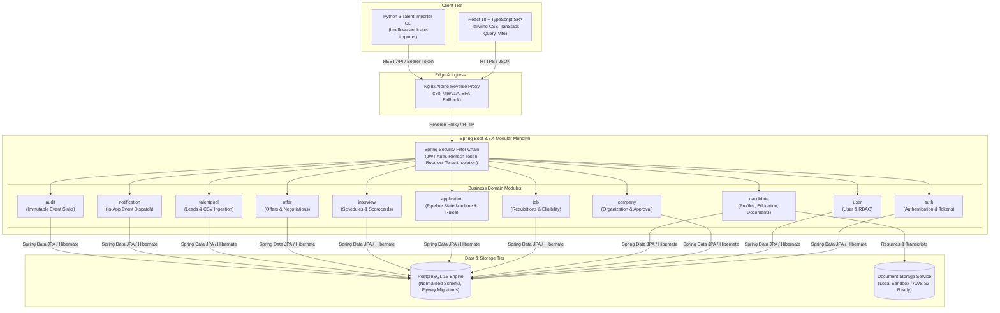
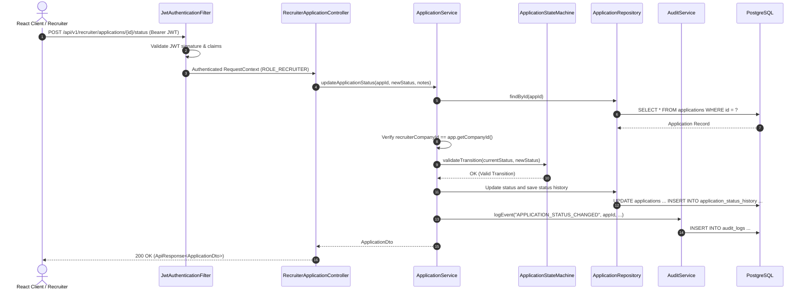

# HireFlow Architecture Specification

## 1. High-Level System Architecture

HireFlow is an enterprise recruitment management and applicant tracking platform (ATS) architected as a **Modular Monolith**. It pairs a high-throughput Java 21 / Spring Boot 3.3 core with a reactive TypeScript / React 18 single-page application and a relational PostgreSQL persistence engine.

---

## 2. Component Breakdown

### 2.1 Backend Core (`backend/`)
- **Runtime:** Java 21 (LTS) on Eclipse Temurin JRE.
- **Framework:** Spring Boot 3.3.4.
- **Data Access:** Spring Data JPA with Hibernate ORM and HikariCP connection pooling.
- **Database Migrations:** Flyway versioned migrations (`V1__init_schema.sql`, `V2__seed_skills.sql`).
- **Security:** Spring Security 6 stateless filter chain using RFC 7519 JWT access tokens and database-backed SHA-256 hashed refresh tokens.
- **File Parsing & Security:** Apache Tika for MIME-type validation and SHA-256 checksumming for uploaded candidate documents.
- **Documentation:** Springdoc OpenAPI 3.0 generating interactive Swagger UI at `/swagger-ui/index.html`.

### 2.2 Frontend Client (`frontend/`)
- **Runtime:** Node.js 20+ with Vite dev server and production bundler.
- **Language:** TypeScript 5.x with strict type checking.
- **State Management:** TanStack Query v5 for server-side cache management, automatic background refetching, and query invalidation.
- **Form Architecture:** React Hook Form and Zod schemas for client-side form validation.
- **Styling:** Tailwind CSS with utility-first responsive layout and custom color palette.
- **Icons:** Lucide React icons.

### 2.3 Secondary Tooling (`tools/candidate-importer/`)
- **CLI Utility:** Python 3.10+ command-line applicant ingestion script with regex-based data validation, duplicate avoidance, and dry-run reporting.

---

## 3. Module Communication & Boundaries

1. **Strict Tenant Isolation:**
   - Every multi-tenant entity (`job_postings`, `applications`, `interviews`, `offers`, `talent_leads`) is partitioned by `company_id`.
   - Recruiters are bound to a verified company via the `recruiter_companies` mapping table.
   - Controllers and services enforce company-level access control on the backend: a recruiter can only view, mutate, or query records belonging to their affiliated organization. Cross-company access attempts immediately result in `403 Forbidden`.

2. **Domain Boundaries without Circular Dependencies:**
   - Modules interact through clean service interfaces and application events.
   - For example, when an `Application` changes state to `SHORTLISTED`, the `ApplicationService` records an entry in `application_status_history`, publishes an in-app `Notification`, and logs an immutable `AuditLog` entry.

3. **Transaction Management:**
   - Critical lifecycle operations (e.g. application submission, candidate offer acceptance, company approval) run under `@Transactional(isolation = Isolation.READ_COMMITTED)`.
   - If an error occurs during multi-step state transitions, transactions rollback cleanly to prevent partial records.

---

## 4. Request Lifecycle

