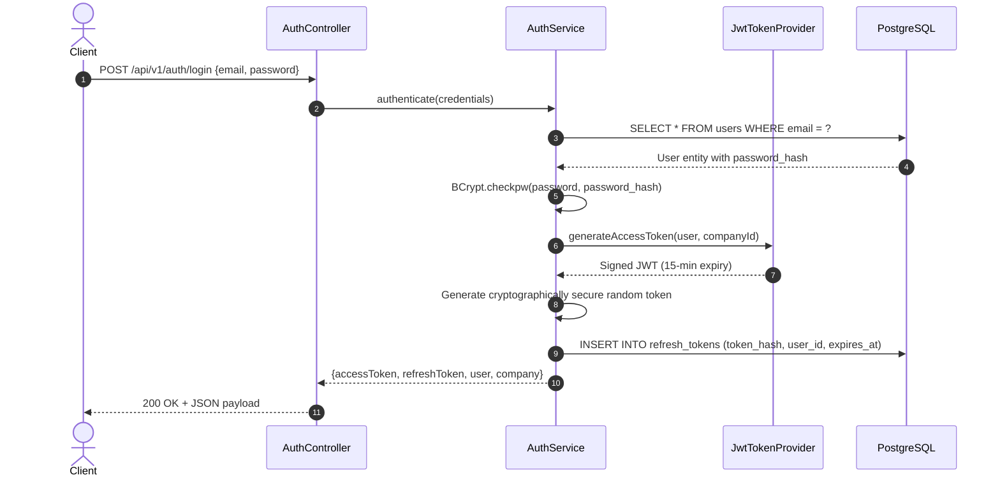

# HireFlow Authentication & Application Security

HireFlow implements a defense-in-depth security model following OWASP enterprise recommendations. Security is enforced in the Spring Boot backend rather than relying on frontend assertions.

---

## 1. Authentication Architecture



---

## 2. JWT Access Token Design

- **Format:** RFC 7519 JSON Web Token signed with HMAC-SHA256 (`HS256`).
- **Signature Key:** Min 256-bit secret loaded via `HIREFLOW_JWT_SECRET` environment variable.
- **Validity Window:** 15 minutes (`900,000 ms`).
- **Claims Payload:**
  ```json
  {
    "sub": "b2c3d4e5-f6a7-8901-bcde-f12345678901",
    "email": "jane.recruiter@techcorp.com",
    "role": "ROLE_RECRUITER",
    "companyId": "a1b2c3d4-e5f6-7890-abcd-ef1234567890",
    "iss": "HireFlow-Platform",
    "iat": 1793700000,
    "exp": 1793700900
  }
  ```
- **Storage on Frontend:** Stored strictly **in-memory** in JavaScript closure variables. Never persisted to `localStorage` to eliminate XSS token theft vectors.

---

## 3. Refresh Token Rotation

1. **Opaque Tokens:**
   - Raw refresh tokens are 64-character hexadecimal strings generated using `java.security.SecureRandom`.
   - The raw token is sent to the client once.
2. **Database Storage:**
   - Only the **SHA-256 hash** of the refresh token is stored in the `refresh_tokens` table. Even with full database read access, an attacker cannot forge valid refresh tokens.
3. **Single-Use Rotation:**
   - Every invocation of `/api/v1/auth/refresh` revokes the old token row and issues a completely new access token and fresh refresh token pair.
   - If an expired or already revoked refresh token is presented, all active refresh tokens for that user are revoked immediately (reuse detection).

---

## 4. Multi-Tenant Isolation

HireFlow enforces strict data isolation between companies:

1. **Company Binding:**
   - Recruiters are bound to their organization via the `recruiter_companies` table.
   - On every request, `SecurityUtils.getCurrentUserCompanyId()` resolves the authenticated recruiter's company UUID from the JWT claims or DB session.
2. **Service Layer Enforcement:**
   - Services verify `app.getCompanyId().equals(recruiterCompanyId)` before returning details, updating status, scheduling interviews, or making offers.
   - If an unauthorized access attempt occurs, an immediate `ForbiddenException("You do not have permission to access records for another organization")` is thrown and an audit entry is generated.
3. **Automated Tenant Isolation Tests:**
   - Verifiable unit tests (`TenantIsolationTest.java`) assert that Recruiter A cannot query or mutate Recruiter B's applications or jobs.

---

## 5. File Upload & Document Security

Candidate resume and transcript uploads are hardened against malware and traversal attacks:

- **MIME-Type Validation:** Content types are detected using **Apache Tika** binary byte-inspection, ignoring spoofed client-supplied `Content-Type` headers or file extensions. Only `application/pdf`, `application/msword`, and `application/vnd.openxmlformats-officedocument.wordprocessingml.document` are accepted.
- **Size Limits:** Enforced at both Nginx (client_max_body_size 10M) and Spring Boot (`spring.servlet.multipart.max-file-size=10MB`).
- **Filename Sanitization:** Input filenames are stripped of path traversal characters (`..`, `/`, `\`) and stored using unique UUID identifiers on disk: `uploads/resumes/{profileId}/{documentId}.pdf`.
- **Integrity Checksums:** An immutable SHA-256 checksum is calculated and stored alongside the document record for tamper evidence.

---

## 6. Password Storage & Validation

- Passwords are encrypted using **BCrypt** with strength factor 12.
- Password complexity requires:
  - Minimum 8 characters.
  - At least one uppercase letter (`A-Z`).
  - At least one lowercase letter (`a-z`).
  - At least one digit (`0-9`).
  - At least one special symbol (`!@#$%^&*()_+-=[]{}|;:,.<>?`).
