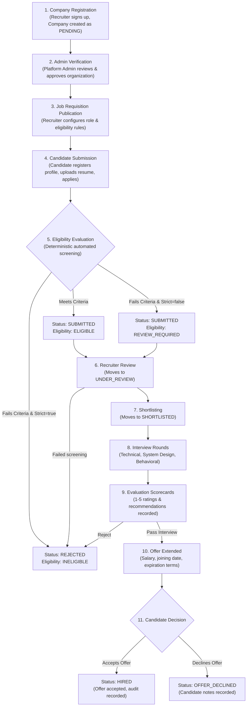

# HireFlow Business Workflows & State Machine

## 1. End-to-End Recruitment Lifecycle

---

## 2. Application State Machine Specification

Applications follow a deterministic finite state machine implemented in `ApplicationStateMachine.java`. Any transition not explicitly listed in the transition table throws an `InvalidStateTransitionException` and is blocked by the transactional boundary.

### 2.1 Transition Matrix

| Current State | Allowed Next States | Trigger / Responsible Actor |
|---|---|---|
| `SUBMITTED` | `UNDER_REVIEW`, `SHORTLISTED`, `REJECTED`, `WITHDRAWN` | Recruiter or Candidate (withdraw) |
| `UNDER_REVIEW` | `SHORTLISTED`, `REJECTED`, `WITHDRAWN` | Recruiter or Candidate (withdraw) |
| `SHORTLISTED` | `INTERVIEW`, `REJECTED`, `WITHDRAWN` | Recruiter or Candidate (withdraw) |
| `INTERVIEW` | `OFFERED`, `REJECTED`, `WITHDRAWN` | Recruiter or Candidate (withdraw) |
| `OFFERED` | `HIRED`, `OFFER_DECLINED`, `REJECTED`, `WITHDRAWN` | Candidate (accept/decline) or Recruiter (withdraw/reject) |
| `HIRED` | *(Terminal State)* | None |
| `REJECTED` | *(Terminal State)* | None |
| `WITHDRAWN` | *(Terminal State)* | None |
| `OFFER_DECLINED`| *(Terminal State)* | None |

### 2.2 Status History Auditing
Whenever a state transition occurs:
1. An entry is appended to `application_status_history` capturing `from_status`, `to_status`, `changed_by_user_id`, `notes`, and UTC `changed_at`.
2. An asynchronous application event is published to notify the candidate via the in-app notification center.
3. An audit log record is created in `audit_logs`.

---

## 3. Eligibility Screening Engine

Screening occurs automatically upon application submission inside `EligibilityEvaluationService.java`:

### 3.1 Evaluated Dimensions
1. **Academic CGPA / Percentage:** Evaluated against `job_eligibility_criteria.min_cgpa` on a standardized 10-point scale.
2. **Secondary Schooling Marks:** Evaluated against `min_tenth_percent` and `min_twelfth_percent`.
3. **Active Academic Backlogs:** Candidate active backlogs must not exceed `max_backlogs`.
4. **Allowed Degrees:** Case-insensitive match against `job_eligible_degrees` (e.g. B.Tech, M.Tech, MCA).
5. **Allowed Branches:** Case-insensitive match against `job_eligible_branches` (e.g. Computer Science, Information Technology).
6. **Graduation Year:** Evaluated against allowed graduation cohorts.

### 3.2 Enforcement Modes
- **Strict Mode (`strict_enforcement = true`):** If any criterion fails, the application is automatically transitioned to `REJECTED` with `eligibility_status = INELIGIBLE`. The detailed rejection reasoning is logged for recruiter review.
- **Advisory Mode (`strict_enforcement = false`):** The application remains active with `eligibility_status = REVIEW_REQUIRED`, highlighting failed parameters to the recruiter without automatic rejection.

---

## 4. Structured Interview Scorecards

1. **Rounds & Types:**
   - Rounds are sequentially numbered (Round 1, Round 2, Round 3).
   - Supported interview types: `PHONE_SCREEN`, `TECHNICAL`, `SYSTEM_DESIGN`, `BEHAVIORAL`, `HIRING_MANAGER`, `HR`, `FINAL`.
2. **Evaluation Dimensions (1 to 5 scale):**
   - Technical Competence
   - Communication Skills
   - Problem Solving & Analytical Thinking
   - Cultural & Values Alignment
   - Overall Score
3. **Recommendations:**
   - `STRONG_HIRE`
   - `HIRE`
   - `LEANING_HIRE`
   - `LEANING_REJECT`
   - `REJECT`

---

## 5. Job Offer Extension & Formalization

1. **Offer Issuance:**
   - Recruiters issue offers to candidates in `INTERVIEW` or `SHORTLISTED` state specifying base salary, currency, joining date, offer expiration timestamp, and employment terms.
   - The application status moves to `OFFERED`.
2. **Candidate Acceptance:**
   - Candidate clicks "Accept Offer" in the candidate portal.
   - The application status updates transactionally to `HIRED`.
   - The offer status transitions to `ACCEPTED`.
   - Notifications and audit logs are dispatched.
3. **Candidate Decline:**
   - Candidate clicks "Decline Offer" and supplies optional negotiation or reasoning notes.
   - The application transitions to `OFFER_DECLINED`.
