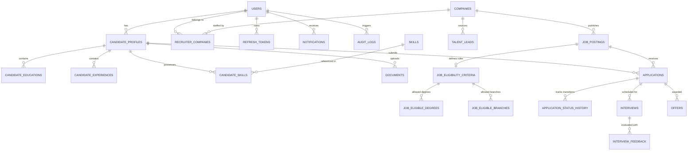

# HireFlow Database Design & Persistence Specification

## 1. Relational Entity-Relationship Diagram

---

## 2. Table Specifications & Indexes

### 2.1 Identity & Multitenancy
- **`users`**: Central authentication table.
  - `id`: UUID (Primary Key)
  - `email`: VARCHAR(255) UNIQUE NOT NULL
  - `password_hash`: VARCHAR(255) NOT NULL (BCrypt)
  - `first_name`, `last_name`, `phone_number`: VARCHAR
  - `role`: VARCHAR(32) NOT NULL (`ROLE_CANDIDATE`, `ROLE_RECRUITER`, `ROLE_ADMIN`)
  - `account_status`: VARCHAR(32) NOT NULL (`ACTIVE`, `PENDING_VERIFICATION`, `SUSPENDED`)
  - `created_at`, `updated_at`: TIMESTAMPTZ NOT NULL

- **`companies`**: Organization tenant definitions.
  - `id`: UUID (Primary Key)
  - `name`: VARCHAR(255) NOT NULL
  - `status`: VARCHAR(32) NOT NULL (`PENDING`, `APPROVED`, `REJECTED`, `SUSPENDED`)
  - `website`, `industry`, `company_size`, `description`, `logo_url`: VARCHAR/TEXT
  - `created_at`, `updated_at`: TIMESTAMPTZ NOT NULL

- **`recruiter_companies`**: Recruiter-to-Company binding table enforcing strict multi-tenancy.
  - `id`: UUID (Primary Key)
  - `recruiter_id`: UUID NOT NULL REFERENCES `users(id)`
  - `company_id`: UUID NOT NULL REFERENCES `companies(id)`
  - `title`: VARCHAR(128)
  - Unique constraint on `(recruiter_id, company_id)`

- **`refresh_tokens`**: Opaque token store with rotation security.
  - `id`: UUID (Primary Key)
  - `token_hash`: VARCHAR(255) UNIQUE NOT NULL (SHA-256 hash of random token)
  - `user_id`: UUID NOT NULL REFERENCES `users(id)`
  - `expires_at`: TIMESTAMPTZ NOT NULL
  - `revoked`: BOOLEAN NOT NULL DEFAULT FALSE

---

### 2.2 Candidate Domain
- **`candidate_profiles`**: Comprehensive profile for applicants.
  - `id`: UUID (Primary Key)
  - `user_id`: UUID UNIQUE NOT NULL REFERENCES `users(id)`
  - `headline`, `summary`, `github_url`, `linkedin_url`, `portfolio_url`: VARCHAR/TEXT

- **`candidate_educations`**: Academic records evaluated during eligibility checks.
  - `id`: UUID (Primary Key)
  - `profile_id`: UUID NOT NULL REFERENCES `candidate_profiles(id)`
  - `institution`: VARCHAR(255) NOT NULL
  - `degree`: VARCHAR(128) NOT NULL (e.g., B.Tech, M.Tech)
  - `field_of_study`: VARCHAR(128) NOT NULL (e.g., Computer Science)
  - `start_date`, `end_date`: DATE
  - `grade_score`: NUMERIC(5,2) (e.g., CGPA 8.75 or Percentage 87.5)
  - `tenth_percent`, `twelfth_percent`: NUMERIC(5,2)
  - `active_backlogs`: INTEGER DEFAULT 0

- **`documents`**: Resumes, transcripts, and portfolios stored on disk or S3.
  - `id`: UUID (Primary Key)
  - `profile_id`: UUID NOT NULL REFERENCES `candidate_profiles(id)`
  - `document_type`: VARCHAR(32) NOT NULL (`RESUME`, `TRANSCRIPT`, `COVER_LETTER`)
  - `original_filename`: VARCHAR(255) NOT NULL
  - `storage_path`: VARCHAR(512) NOT NULL
  - `file_size_bytes`: BIGINT NOT NULL
  - `mime_type`: VARCHAR(128) NOT NULL (validated via Apache Tika)
  - `sha256_checksum`: VARCHAR(64) NOT NULL

---

### 2.3 Job & Eligibility Rules
- **`job_postings`**: Company job requisitions.
  - `id`: UUID (Primary Key)
  - `company_id`: UUID NOT NULL REFERENCES `companies(id)`
  - `created_by_recruiter_id`: UUID NOT NULL REFERENCES `users(id)`
  - `title`: VARCHAR(255) NOT NULL
  - `department`, `location`: VARCHAR(128)
  - `workplace_type`: VARCHAR(32) (`ON_SITE`, `HYBRID`, `REMOTE`)
  - `employment_type`: VARCHAR(32) (`FULL_TIME`, `PART_TIME`, `CONTRACT`, `INTERNSHIP`)
  - `status`: VARCHAR(32) (`DRAFT`, `PUBLISHED`, `CLOSED`, `ARCHIVED`)
  - `salary_min`, `salary_max`: NUMERIC(15,2)
  - `currency`: VARCHAR(8) DEFAULT 'USD'
  - `application_deadline`: TIMESTAMPTZ

- **`job_eligibility_criteria`**: Deterministic automated screening rules.
  - `id`: UUID (Primary Key)
  - `job_id`: UUID UNIQUE NOT NULL REFERENCES `job_postings(id)`
  - `min_cgpa`: NUMERIC(4,2)
  - `min_tenth_percent`, `min_twelfth_percent`: NUMERIC(5,2)
  - `max_backlogs`: INTEGER DEFAULT 0
  - `strict_enforcement`: BOOLEAN DEFAULT TRUE

- **`job_eligible_degrees`** & **`job_eligible_branches`**: Target qualification white-lists.

---

### 2.4 Application Pipeline, Interviews & Offers
- **`applications`**: Core tracking record.
  - `id`: UUID (Primary Key)
  - `job_id`: UUID NOT NULL REFERENCES `job_postings(id)`
  - `candidate_id`: UUID NOT NULL REFERENCES `users(id)`
  - `resume_document_id`: UUID REFERENCES `documents(id)`
  - `status`: VARCHAR(32) (`SUBMITTED`, `UNDER_REVIEW`, `SHORTLISTED`, `INTERVIEW`, `OFFERED`, `HIRED`, `REJECTED`, `WITHDRAWN`, `OFFER_DECLINED`)
  - `eligibility_status`: VARCHAR(32) (`ELIGIBLE`, `INELIGIBLE`, `MANUALLY_OVERRIDDEN`)
  - `eligibility_reason`: TEXT
  - `applied_at`: TIMESTAMPTZ NOT NULL
  - Unique constraint on `(job_id, candidate_id)` preventing duplicate submissions.

- **`application_status_history`**: Immutable lifecycle audit trail.
  - `id`: UUID (Primary Key)
  - `application_id`: UUID NOT NULL REFERENCES `applications(id)`
  - `from_status`: VARCHAR(32)
  - `to_status`: VARCHAR(32) NOT NULL
  - `changed_by_user_id`: UUID REFERENCES `users(id)`
  - `changed_at`: TIMESTAMPTZ NOT NULL
  - `notes`: TEXT

- **`interviews`** & **`interview_feedback`**: Structured interview rounds and scorecards.
- **`offers`**: Official job offers with salary, start date, expiration, and candidate acceptance/rejection notes.

---

## 3. Database Migration Strategy (Flyway)

1. **Version Control:**
   - All DDL and seed migrations reside in `backend/src/main/resources/db/migration/`.
   - `V1__init_schema.sql`: Establishes all 22 tables, foreign keys, check constraints, and performance indexes.
   - `V2__seed_skills.sql`: Seeds reference technological skills.
2. **Deterministic Startup:**
   - On application launch, Flyway validates checksums of previous migrations before applying pending scripts.
   - Hibernate `ddl-auto` is set to `validate` in production, ensuring Hibernate never alters production tables dynamically.
